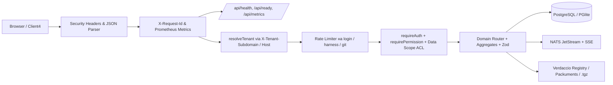

# Архитектура и эксплуатация NexusHarness CRM & Portal

## Слои приложения и DDD Bounded Contexts

```text
packages/                            # Выделенные программные модули (Verdaccio @nexus-core/* и @nexus-plugins/*)
├── ddd-kernel/                      # @nexus-core/ddd-kernel (Shared Kernel: AggregateRoot, Entity, ValueObject, Money)
├── dify-deal-copilot/               # @nexus-plugins/dify-deal-copilot (Bounded Context: crm)
├── nats-webhook-bridge/             # @nexus-plugins/nats-webhook-bridge (Bounded Context: integration / Published Language)
├── vk-social-polls/                 # @nexus-plugins/vk-social-polls (Bounded Context: social / SocialPollAggregate)
├── directus-bi-connector/           # @nexus-plugins/directus-bi-connector (Bounded Context: analytics / Anti-Corruption Layer)
└── tinacms-sales-playbooks/         # @nexus-plugins/tinacms-sales-playbooks (Bounded Context: cms)

src/
├── domain/                          # Агрегаты (DealAggregate, PluginPackageAggregate), Value Objects, порты, Zod-схемы, RBAC
├── application/                     # Express роутеры, middleware (auth, security, observability), hooks/клиенты
├── infrastructure/                  # Drizzle ORM + PostgreSQL/PGlite, Verdaccio Registry Adapter, NATS JetStream, Mattermost WS, Garage S3, Forgejo, OpenAPI
└── presentation/                    # React 19 UI, lazy-модули разделов, Voice Navigation, ErrorBoundary, ToastStack
```

## Карта контекстов (DDD Context Mapping & Verdaccio)

| Программный модуль | Bounded Context | Context Mapping | Ключевые агрегаты и объекты-значения |
| --- | --- | --- | --- |
| `@nexus-core/ddd-kernel` | `shared-kernel` | Shared Kernel | `AggregateRoot`, `Entity`, `ValueObject`, `Money`, `VerdaccioPackageName` |
| `@nexus-plugins/dify-deal-copilot` | `crm` | Customer-Supplier | `WinProbability`, `evaluateDealCopilot()` |
| `@nexus-plugins/nats-webhook-bridge` | `integration` | Published Language | `WebhookRetryPolicy`, `buildWebhookDeliveryPlan()` |
| `@nexus-plugins/vk-social-polls` | `social` | Customer-Supplier | `SocialPollAggregate` |
| `@nexus-plugins/directus-bi-connector` | `analytics` | Anti-Corruption Layer | `SyncSchedule`, `translateInternalRecordToBiDto()` |
| `@nexus-plugins/tinacms-sales-playbooks` | `cms` | Customer-Supplier | `matchSalesPlaybook()` |

## Поток обработки HTTP-запроса



## Наблюдаемость и DevOps

| Endpoint / Сигнал | Назначение | Формат / Код ответа |
| --- | --- | --- |
| `GET /api/health` | Liveness + SQL `SELECT 1` к PostgreSQL | `200 OK` / `503 Service Unavailable` |
| `GET /api/ready` | Readiness + наличие инициализированных тенантов | `200 OK` / `503 Service Unavailable` |
| `GET /api/metrics` | Метрики HTTP, памяти, Mattermost WS, NATS SSE | `text/plain; version=0.0.4` или JSON |
| `GET /api/marketplace/verdaccio/modules` | Выделенные модули `packages/*` и статус Verdaccio | `200 OK` |
| `GET /api/marketplace/verdaccio/registry/:scope/:pkg` | Packument JSON (dist-tags, SHA-512, tarball) | `200 OK` |
| `GET /api/system/health` | CPU, RAM, HDD, NET и статусы PostgreSQL/NATS/Forgejo/S3 | `200 OK` (требует авторизацию) |
| `X-Request-Id` | Корреляция запросов в логах и ответах ошибок | Заголовок ответа + поле `requestId` |
| `SIGTERM` / `SIGINT` | Плавное завершение HTTP, WebSocket и пула БД | Exit code `0` |

## Переменные окружения

См. `.env.example` — все внешние интеграции (`POSTGRES_URL`, `NATS_URL`, `VERDACCIO_URL`, `DIRECTUS_URL`, `DIFY_API_URL`, `FORGEJO_*`, `GARAGE_*`, `SESSION_SECRET`) настраиваются через переменные окружения. При запуске без внешних сервисов платформа работает автономно на встроенном PostgreSQL (`@electric-sql/pglite`), встроенном Verdaccio workspace registry (`packages/*`), локальном хранилище S3 и in-process шине NATS.
